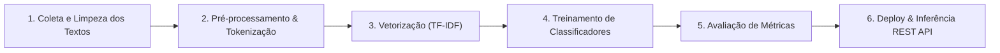

# Mineração de Dados: Yelp, sentimento e agrupamento de estabelecimentos

**Projeto Interdisciplinar (PI) – 6º Semestre**  
**Disciplina-Satélite:** Mineração de Dados  
**Professor Responsável:** Prof. Me. Alexandre Gomes  
**Tema:** Sistema de Agendamento de Serviços Multiplataforma  
**Atualização em 23/10/2026:** classificação baseline executável sobre amostra local; coleta Yelp completa e modelo integrado ainda não comprovados.

---

## 1. Visão Geral do Problema de Negócio

No módulo de avaliações do sistema (**RF09** e **RF10**), os clientes expressam sua percepção sobre o serviço recebido por meio de uma nota quantitativa (1 a 5 estrelas) e um comentário descritivo textual.

A leitura individual e manual de cada comentário se torna inviável à medida que o volume de atendimentos cresce. Portanto, o objetivo da frente de **Mineração de Dados** é construir e integrar um pipeline de **Processamento de Linguagem Natural (PLN / NLP)** e **Classificação Supervisionada**, capaz de categorizar automaticamente os feedbacks em **Positivo** ou **Negativo** com inferência inferior a 1 segundo (**RNF02**), alimentando os indicadores de satisfação do prestador (**RF11**).

---

## 2. Definição da Base de Dados (Dataset)

### 2.1 Base de Dados de Referência: Yelp Open Dataset (Kaggle)
Como fonte de dados oficial e benchmark de mercado para o projeto, foi definida a base pública **Yelp Dataset** disponibilizada no Kaggle:
- **Link Oficial no Kaggle:** [Yelp Dataset (Kaggle)](https://www.kaggle.com/datasets/yelp-dataset/yelp-dataset)
- **Origem e Relevância:** Trata-se de um dos maiores e mais consagrados conjuntos de dados abertos para mineração de texto e análise de sentimentos do mundo, contendo mais de **6,9 milhões de avaliações reais** e 150.000 estabelecimentos e prestadores de serviços comerciais.
- **Justificativa de Escolha:** É o padrão ouro (*benchmark*) da literatura científica para avaliação de serviços locais (salões de beleza, barbearias, estética, reparos automotivos, educação e consultorias), fornecendo exatamente a mesma tipologia de dados gerada pelo nosso sistema de agendamento (texto de opinião livre associado a notas de 1 a 5 estrelas).

### 2.2 Estrutura e Especificação das Features
A base analítica processada e adaptada para o pipeline de Machine Learning do projeto é composta pelos seguintes campos:

| Campo | Equivalente no Yelp | Tipo | Descrição | Papel no Modelo |
| :--- | :--- | :--- | :--- | :--- |
| `id_avaliacao` | `review_id` | Inteiro/String | Identificador da avaliação | Metadado / ID |
| `nota_estrelas` | `stars` | Inteiro (1 a 5) | Avaliação quantitativa do cliente | Feature auxiliar / Validação |
| `comentario_texto`| `text` | Texto (String) | Opinião redigida pelo cliente | **Feature Principal (Entrada de Texto)** |
| `sentimento` | *Mapeamento (`stars`)*| Categórico | Rótulo da classe (`Positivo` ou `Negativo`) | **Target / Variável Alvo ($y$)** |
| `categoria_servico`| `categories` | Categórico | Segmento (Barbearia, Estética, Oficina, Consultoria, etc.) | Metadado para análise setorial |

### 2.3 Estratégia de Amostragem, Balanceamento e Sprints
- **Critério de Mapeamento de Classes:**
  - **Positivo:** Avaliações de 4 e 5 estrelas ($stars \ge 4$).
  - **Negativo:** Avaliações de 1 e 2 estrelas ($stars \le 2$).
  - *(Avaliações de 3 estrelas são filtradas na classificação binária por representarem neutralidade).*
- **1ª Sprint (Validação e Prova de Conceito):** Foi extraída uma amostra representativa de 100 avaliações estruturada em [`data-mining/dataset_avaliacoes_exemplo.csv`](dataset_avaliacoes_exemplo.csv), com balanceamento entre termos positivos e negativos e adaptação linguística para expressões cotidianas de serviços locais no Brasil.
- **2ª Sprint:** execução reproduzível do baseline no CSV de amostra, com comparação inicial entre Naive Bayes Multinomial e Regressão Logística e geração de relatório de métricas.
- **3ª Sprint:** coleta/filtragem do dataset autorizado, avaliação do modelo escolhido e integração do classificador treinado com a API são itens a concluir e documentar; ainda não estão implementados como carga automática.

---

## 3. Planejamento das Técnicas de Mineração de Dados

O fluxo metodológico segue as diretrizes do framework **CRISP-DM** (*Cross-Industry Standard Process for Data Mining*):



### 3.1 Etapa 1: Limpeza e Normalização de Texto
- Conversão de todo o texto para letras minúsculas (*lowercasing*).
- Remoção de caracteres especiais, números pontuais e pontuações desnecessárias.
- Tratamento de acentuação e preservação de expressões de polaridade (*não*, *nunca*, *péssimo*, *maravilhoso*).

### 3.2 Etapa 2: Pré-processamento e Stopwords em Português
- **Tokenização:** Divisão da sentença em palavras (*tokens*).
- **Filtragem de Stopwords:** Remoção de termos gramaticais de baixa carga semântica (artigos, preposições: *de*, *para*, *o*, *a*, *com*), mantendo termos de negação cruciais para a análise de sentimento.
- **Stemming / Lemmatização:** Redução das palavras ao seu radical (usando o algoritmo RSLP da biblioteca NLTK).

### 3.3 Etapa 3: Extração de Características (Vetorização)
- Adoção de **TF-IDF (Term Frequency - Inverse Document Frequency)**:
  $$TF\text{-}IDF(t, d, D) = TF(t, d) \times \log\left(\frac{|D|}{1 + |\{d \in D : t \in d\}|}\right)$$
- Utilização de *unigramas* e *bigramas* (`ngram_range=(1, 2)`) para capturar expressões compostas importantes (ex: "não gostei", "muito bom", "péssimo atendimento").

### 3.4 Etapa 4: Algoritmos candidatos e baseline executável
O script atual treina e compara dois candidatos na amostra:
1. **Multinomial Naive Bayes (MNB):** Modelo probabilístico baseado no Teorema de Bayes com suposição de independência condicional. Extremamente rápido na predição (< 50ms) e altamente eficaz em dados esparsos de texto.
2. **Regressão Logística (Logistic Regression):** Modelo linear robusto que oferece estimativas calibradas de probabilidade de pertencimento à classe Positiva/Negativa.
Um LinearSVC pode ser adicionado como experimento futuro; ele não é treinado pelo script atual.

### 3.5 Etapa 5: Métricas de Avaliação
O baseline atual usa uma divisão estratificada de 75% treino / 25% teste, com semente fixa para reprodutibilidade. A vetorização é ajustada somente com o conjunto de treino para evitar vazamento de vocabulário. O relatório inclui:
- **Acurácia:** Proporção geral de acertos.
- **Precisão (Precision):** Capacidade de não classificar como positivo um comentário negativo.
- **Revocação (Recall):** Capacidade de identificar todos os comentários positivos/negativos reais.
- **F1-Score:** Média harmônica entre precisão e revocação:
  $$F_1 = 2 \times \frac{\text{Precision} \times \text{Recall}}{\text{Precision} + \text{Recall}}$$
- **Matriz de Confusão:** Visualização de verdadeiros positivos, falsos positivos, verdadeiros negativos e falsos negativos.

### 3.6 Etapa 6: Latência e integração (RNF02)
O endpoint `POST /api/ai/sentiment-analysis` e o envio de avaliações usam atualmente uma classificação lexical implementada em [`backend/src/services/sentiment.service.ts`](../backend/src/services/sentiment.service.ts). Ela não carrega o modelo TF-IDF treinado pelo script; a confiança retornada pelo endpoint é heurística, não probabilidade calibrada. A latência medida pelo endpoint pode ser evidenciada, mas não representa desempenho do modelo sklearn. A serialização e integração do classificador treinado são trabalho pendente da Sprint 3.

---

## 4. Evidências Práticas e Artefatos da Sprint 2

Os artefatos implementados para esta etapa encontram-se estruturados na pasta `/data-mining`:
- **Dataset de amostra:** [`data-mining/dataset_avaliacoes_exemplo.csv`](../data-mining/dataset_avaliacoes_exemplo.csv).
- **Script de treinamento e avaliação:** [`data-mining/analise_sentimento.py`](../data-mining/analise_sentimento.py).
- **Relatório reproduzível:** execute `python analise_sentimento.py` para gerar `resultados_sentimento.json` com distribuição, acurácia, relatório por classe, matriz de confusão e tempos de inferência.
- **Classificador da API (baseline lexical, distinto do modelo sklearn):** [`backend/src/services/sentiment.service.ts`](../backend/src/services/sentiment.service.ts).

O grupo deve arquivar o relatório gerado e capturas do terminal como evidência da execução real; resultados não devem ser copiados de execuções não realizadas.

---

## 5. Agrupamento não supervisionado de estabelecimentos

Além da análise de sentimento, o repositório contém um script opcional para agrupar negócios Yelp sem rótulos prévios. A execução depende de obter o dataset; sem o arquivo original, essa análise não foi executada nem deve ser reportada como resultado validado.

### 5.1 Obtenção dos dados

O Yelp Dataset é distribuído pelo [Kaggle](https://www.kaggle.com/datasets/yelp-dataset/yelp-dataset) e requer uma conta e aceitação dos termos aplicáveis. A base completa é grande; por isso, os arquivos originais não devem ser commitados no repositório. Baixe o arquivo pelo botão **Download** da página do dataset, extraia `yelp_academic_dataset_business.json` e coloque-o em `data-mining/dataset/`. Essa pasta é ignorada pelo Git.

### 5.2 Preparação e atributos

O script [`data-mining/agrupamento_estabelecimentos.py`](../data-mining/agrupamento_estabelecimentos.py) lê o JSON Lines de negócios e usa:

- nota média (`stars`) e quantidade de avaliações (`review_count`, transformada com `log1p`);
- situação aberta/fechada (`is_open`) e localização (latitude e longitude);
- estado (`state`) e categorias comerciais (`categories`).

Registros sem categoria ou coordenadas são removidos. Atributos numéricos são padronizados, estados são codificados e categorias são representadas com TF-IDF. O K-Means encontra os grupos sem utilizar as notas como rótulos-alvo. O script informa tamanho dos clusters e silhouette score aproximado em uma amostra, além de salvar os rótulos em CSV.

### 5.3 Execução

Com Python 3.10 ou superior e o arquivo baixado na pasta indicada:

```bash
cd data-mining
pip install pandas scikit-learn
python agrupamento_estabelecimentos.py
```

O padrão cria `data-mining/resultados_agrupamento.csv` com cinco grupos. É possível mudar os parâmetros, por exemplo:

```bash
python agrupamento_estabelecimentos.py --input dataset/yelp_academic_dataset_business.json --clusters 6 --output resultados/negocios_clusterizados.csv
```

### 5.4 Interpretação e limitações

O número de grupos (`--clusters`) e os atributos escolhidos afetam o resultado. Coordenadas podem fazer a proximidade geográfica pesar na formação dos grupos; notas, popularidade e categorias também refletem dimensões distintas do negócio. Silhouette é uma medida auxiliar, não prova que os grupos sejam úteis. Compare perfil, categorias e distribuição de cada cluster e valide a interpretação com o contexto do problema antes de usá-la para decisões. K-Means também pode não representar bem grupos de formatos irregulares ou tamanhos muito diferentes.
